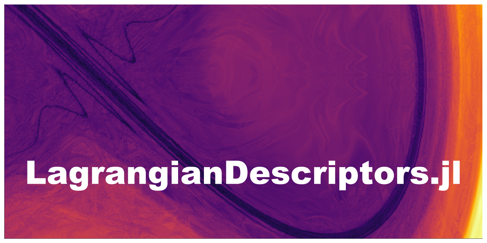
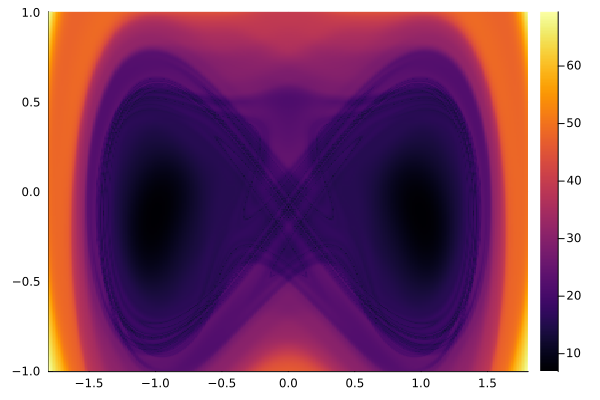
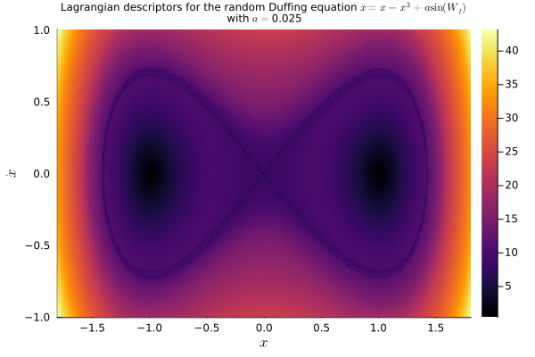

# Lagrangian Descriptors

[](https://juliadynamics.github.io/LagrangianDescriptors.jl/dev/)  [](https://codecov.io/gh/JuliaDynamics/LagrangianDescriptors.jl) [](https://opensource.org/licenses/MIT) 



Implementation of the method of **Lagrangian Descriptors** to highlight singular features (e.g. stable or unstable invariant manifolds) of the dynamics of an evolutionary system (such as ordinary or partial differential equations, random equations, or stochastic differential equations).

## Examples

### Periodically forced Duffing oscillator

Here is an example on a periodically forced Duffing system.

```julia
using OrdinaryDiffEq, Plots
using LinearAlgebra: norm
using LagrangianDescriptors

function f!(du, u, p, t)
    x, y = u
    A, ω = p
    du[1] = y
    du[2] = x - x^3 + A * sin(ω * t)
end

u0 = [0.5, 2.2]
tspan = (0.0, 13.0)
A = 0.3; ω = π

p = (A, ω)
prob = ODEProblem(f!, u0, tspan, p)

M(du, u, p, t) = norm(du)

uu0 = [[x, y] for y in range(-1.0, 1.0, length=301), x in range(-1.8, 1.8, length=301)]

lagprob = LagrangianDescriptorProblem(prob, M, uu0)
```

With all setup, we may solve it as follows:

```
julia> @time lagsol = solve(lagprob, Tsit5())
  1.592059 seconds (69.85 M allocations: 3.762 GiB, 21.25% gc time)
```

Then we use the built-in plot recipe to get the heatmap of the Lagrangian descriptors:

```julia
plot(lagsol, title="Lagrangian descriptors for the forced Duffing equation \$\\ddot x = x - x^3 + A\\sin(\\omega t)\$\nwith A=$A and ω=$(round(ω, digits=3))", titlefont=8, xlabel="\$x\$", ylabel="\$\\dot x\$")
```



### Random Duffing oscillator

And here is a painting of a *random* Duffing oscillator, detailed in the Tutorials part of the documentation:



## References

* J. A. Jiménez Madrid and A. M. Mancho, *Distinguished trajectories in time dependent vector fields*, Chaos **19**, 013111 (2009). [doi:10.1063/1.3056050](https://doi.org/10.1063/1.3056050)
* A. M. Mancho, S. Wiggins, J. Curbelo and C. Mendoza, *Lagrangian descriptors: A method for revealing phase space structures of general time dependent dynamical systems*, Communications in Nonlinear Science and Numerical Simulation **18**, 3530–3557 (2013). [doi:10.1016/j.cnsns.2013.05.002](https://doi.org/10.1016/j.cnsns.2013.05.002)
* F. Balibrea-Iniesta, C. Lopesino, S. Wiggins and A. M. Mancho, *Lagrangian Descriptors for Stochastic Differential Equations: A Tool for Revealing the Phase Portrait of Stochastic Dynamical Systems*, International Journal of Bifurcation and Chaos **26**, 1630036 (2016). [doi:10.1142/S0218127416300366](https://doi.org/10.1142/S0218127416300366)
* A. M. Mancho, [*Frequently Asked Questions about Lagrangian Descriptors*](https://acp.copernicus.org/preprints/acp-2016-633/acp-2016-633-SC2-supplement.pdf), interactive comment in Atmospheric Chemistry and Physics Discussions (2016).
* C. Lopesino, F. Balibrea-Iniesta, V. J. García-Garrido, S. Wiggins and A. M. Mancho, *A Theoretical Framework for Lagrangian Descriptors*, International Journal of Bifurcation and Chaos **27**, 1730001 (2017). [doi:10.1142/S0218127417300014](https://doi.org/10.1142/S0218127417300014)
* M. Agaoglou, B. Aguilar-Sanjuan, V. J. García Garrido, F. González-Montoya, M. Katsanikas, V. Krajňák, S. Naik and S. Wiggins, [*Lagrangian Descriptors: Discovery and Quantification of Phase Space Structure and Transport*](https://champsproject.github.io/lagrangian_descriptors/), The CHAMPS Project (2020). [doi:10.5281/zenodo.3958985](https://doi.org/10.5281/zenodo.3958985)
* V. J. García-Garrido and J. García-Luengo, *Painting the phase space of dissipative systems with Lagrangian descriptors*, Communications in Nonlinear Science and Numerical Simulation **104**, 106034 (2022). [doi:10.1016/j.cnsns.2021.106034](https://doi.org/10.1016/j.cnsns.2021.106034)
* S. Wiggins and V. J. García-Garrido, *Painting the Phase Portrait of a Dynamical System with the Computational Tool of Lagrangian Descriptors*, Notices of the American Mathematical Society **69**(6) (2022). [doi:10.1090/noti2489](https://doi.org/10.1090/noti2489)
